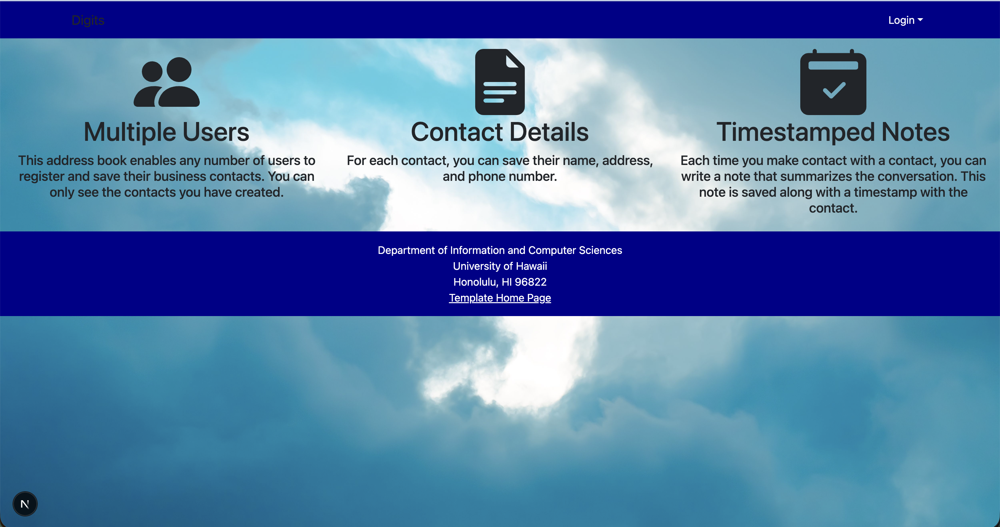
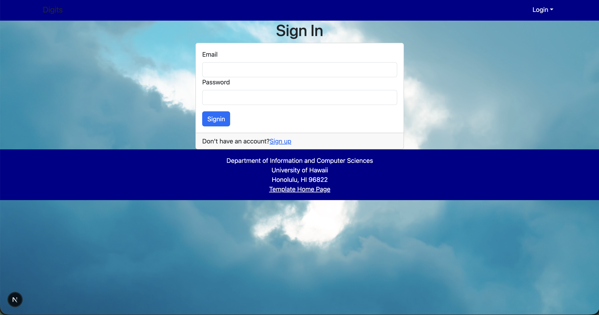
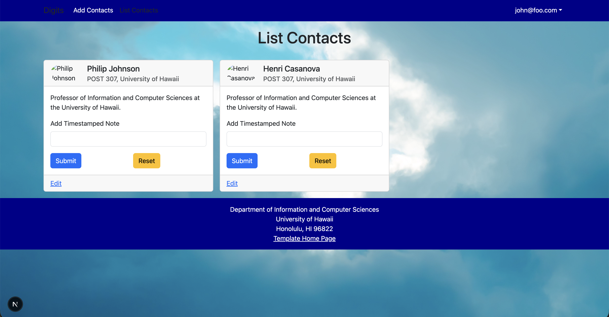
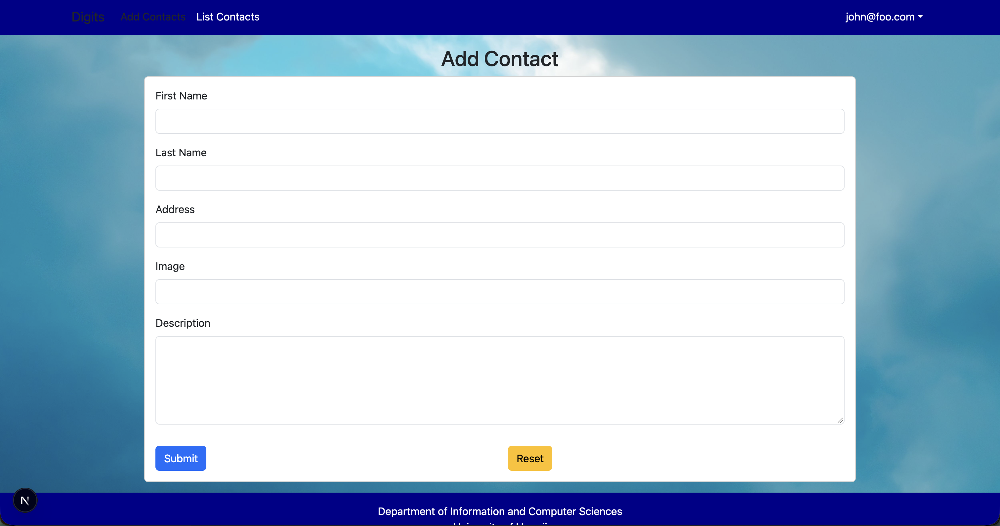
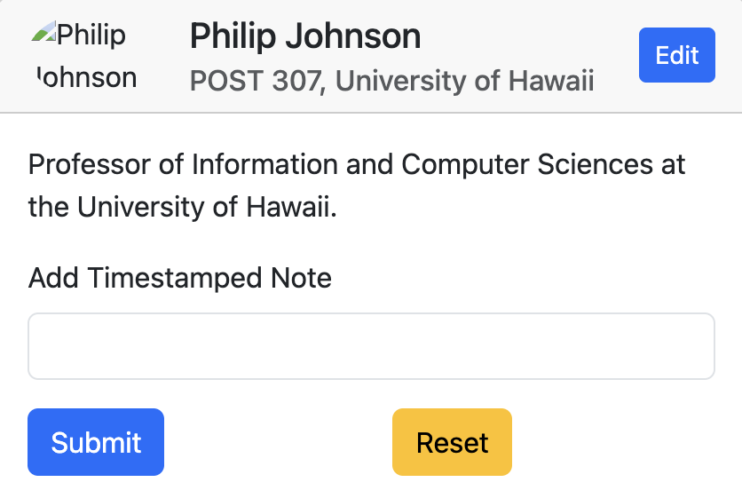
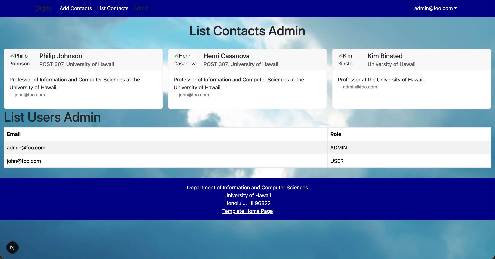

# Digits

Digits is a Next.js application for managing a personal list of contacts, built for ICS 314 at the University of Hawaiʻi. Each user has their own contacts, can add and edit them, and can attach timestamped notes to any contact. Admin users can see every user's contacts.

It is built with Next.js, React Bootstrap, React Hook Form, NextAuth, and Prisma on PostgreSQL.

## Installation

1. Install [Node.js](https://nodejs.org/) and [PostgreSQL](https://www.postgresql.org/download/) (on a Mac, [Postgres.app](https://postgresapp.com/) is the easiest option).

2. Clone the repository and install the dependencies:

   ```
   git clone https://github.com/maherman0/digits.git
   cd digits
   npm install
   ```

3. Create the database:

   ```
   createdb digits
   ```

4. Copy `sample.env` to `.env`, then make sure `DATABASE_URL` points to your local `digits` database.

5. Create the tables and load the default users and contacts:

   ```
   npx prisma migrate dev
   npx prisma generate
   npx prisma db seed
   ```

6. Start the app:

   ```
   npm run dev
   ```

7. Open [http://localhost:3000](http://localhost:3000). You can log in with these seeded accounts:

   | Email | Password | Role |
   |---|---|---|
   | john@foo.com | changeme | User |
   | admin@foo.com | changeme | Admin |

## Walkthrough

### Landing page


The landing page introduces the app's three main features: support for multiple users, contact details, and timestamped notes. Use the **Login** menu at the top right to sign in or sign up.

### Sign in



Log in with an existing account, or choose **Sign up** from the Login menu to create a new one.

### List Contacts



After logging in, **List Contacts** shows each of your contacts as a card with their picture, address, and description. Each card lists that contact's notes with the date they were written, and has a form for adding a new note.

### Add Contact



**Add Contacts** lets you create a new contact by entering a first name, last name, address, image URL, and description.

### Edit Contact



Each contact card has an **Edit** button in its top-right corner. Clicking it opens the Edit Contact page, a form pre-filled with that contact's first name, last name, address, image, and description. Change any field and click **Submit** to save.

### Admin



Users with the Admin role see an **Admin** link in the navbar. The admin page lists every contact in the system along with who owns it, plus a list of all registered users.
